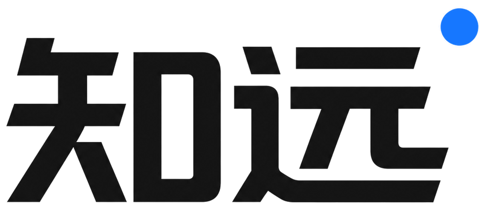
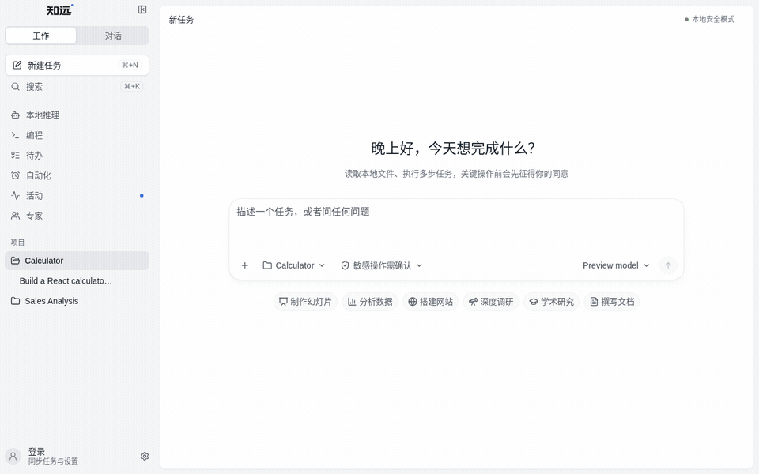
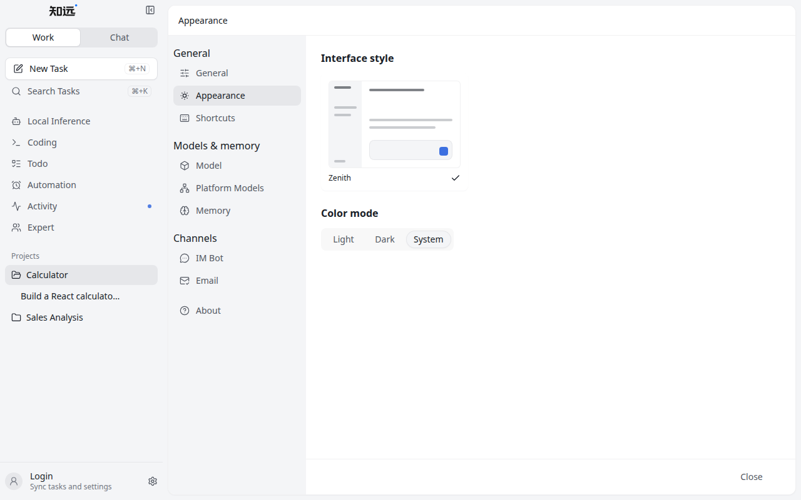
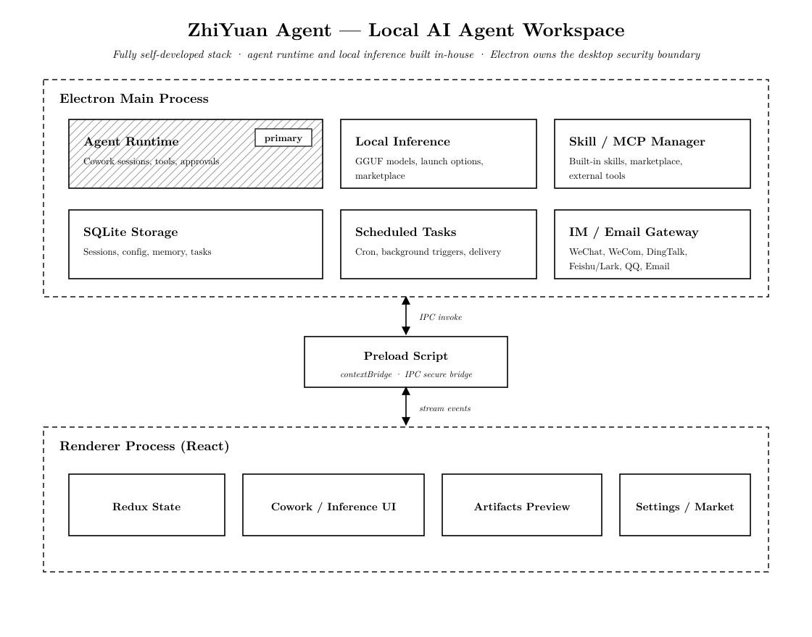

<p align="center">
  <picture>
    <source media="(prefers-color-scheme: dark)" srcset="public/zhiyuan-logo-dark-1600.png">
    
  </picture>
</p>

<h1 align="center">ZhiYuan Agent</h1>

<p align="center"><strong>The open-source, local-first desktop AI agent — start free with a built-in model, run GGUF models locally, and assign tasks from WeChat, Feishu or DingTalk.</strong></p>

<p align="center">
  <a href="https://github.com/rongxinzy/RongxinAI/stargazers"></a>
  <a href="https://github.com/rongxinzy/RongxinAI/releases"></a>
  <a href="LICENSE"></a>
  <a href="https://github.com/rongxinzy/RongxinAI/actions/workflows/ci.yml"></a>
  
</p>

<p align="center">
  <a href="https://www.rongxzyai.com/#download"><b>⬇️ Download</b></a> ·
  <a href="#get-started">Quick start</a> ·
  <a href="#developer-quick-start">Build from source</a> ·
  <a href="README_zh.md">中文</a>
</p>

<p align="center">
  
</p>

## Why ZhiYuan

- 🆓 **Free to start** — built-in ZhiYuan free model, no third-party API key needed (network required; limits shown in app). Bring your own provider anytime.
- 💻 **Runs local models** — browse a model marketplace, pick a GGUF model & quantization, tune context / GPU / threads, powered by llama.cpp runtime.
- 🛠️ **Actually does the work** — reads & writes files, runs commands, operates a browser; creates PPT, Word, PDF, Excel outputs.
- 💬 **Lives in your chat apps** — WeChat, WeCom, DingTalk, Feishu/Lark, QQ, email.
- 🧩 **Extensible** — Experts, Skills and MCP; scheduled recurring tasks.
- 🔒 **Local first** — sessions, config and task metadata stored locally; approval modes for tool execution.

## Get started

1. **Download** the installer from the [official website](https://www.rongxzyai.com/#download) or [GitHub Releases](https://github.com/rongxinzy/RongxinAI/releases). GitHub Releases currently ships a **Windows** installer; macOS and Linux packages are unconfirmed—check the download page.
2. **Open the app** and chat with the built-in free model — no API key required.
3. **Pick a project folder**, describe your task, then follow progress and approve actions as it works.

Developers: `git clone https://github.com/rongxinzy/RongxinAI.git ZhiYuanAgent && cd ZhiYuanAgent && bun install && bun run electron:dev` (Node 24.x, Bun 1.4.0). See [Developer quick start](#developer-quick-start) for prerequisites and more commands.

The free model requires a network connection; availability and usage limits are shown in the app. You can also [run from source](#developer-quick-start) on other platforms.

### Use local models

Open the local inference workspace, browse the model marketplace, and choose a GGUF model and quantization suited to your hardware. Install the model and start its service. Adjust context length, GPU allocation, threads, and other options, then use a running local model for agent tasks.

Local models reduce reliance on cloud inference. Web search, model downloads, remote MCP services, and messaging channels still require their respective network services.

### Data and permissions

Sessions, configuration, and task metadata are stored locally. The desktop execution environment accesses local files. When you use a cloud model or remote tool, the content needed for that request is sent to the corresponding service.

Tool execution follows the selected permission mode. Operations requiring approval display a request; automatic authorization allows some operations to run directly. Progress and results remain visible in the workspace.

## How it compares

| | ZhiYuan | Manus | Claude Desktop | Cherry Studio | Open Interpreter |
| --- | :-: | :-: | :-: | :-: | :-: |
| Assign tasks from WeChat / Feishu / DingTalk | ✅ (also WeCom, QQ, email) | ❌ (Slack, Gmail connectors) | ❌ (Slack connector) | ❌ | ❌ |
| Open-source desktop app | ✅ AGPL-3.0 | ❌ closed source | ❌ closed source | ✅ AGPL-3.0 | ❌ Apache-2.0 terminal app; GUI is a separate project |
| Built-in GGUF model market (no Ollama needed) | ✅ llama.cpp runtime | ❌ cloud only | ❌ cloud only | ❌ via Ollama / LM Studio | ❌ via Ollama / LM Studio |
| Free model + local model + fully open source | ✅ all three | ❌ free tier only (300 credits/day) | ❌ free tier only | ✅ CherryAI free (Qwen3-8B) + Ollama/LM Studio | ❌ no built-in free model |
| Agent: files + commands + browser | ✅ | ✅ | ✅ paid plans only (Cowork) | ? | ✅ (browser via QA skill) |

---

<p align="center">⭐ <b>If ZhiYuan helps you, please star the repo</b> — it helps more people find it and keeps us shipping.</p>

## Star History

<a href="https://star-history.com/#rongxinzy/RongxinAI&Date">
  <picture>
    <source media="(prefers-color-scheme: dark)" srcset="https://api.star-history.com/svg?repos=rongxinzy/RongxinAI&type=Date&theme=dark">
    
  </picture>
</a>

## Choose your workspace appearance

ZhiYuan includes **Codex**, **Daming Fenghua**, **Changan Fengwu**, and **Weiyang Jinshi** themes. Codex uses neutral surfaces and compact controls. Daming Fenghua combines paper white, cinnabar, and ink. Changan Fengwu adds silk white, peacock green, warm bronze, rounder controls, and a deep green night appearance. Weiyang Jinshi combines lacquer black, stone white, antique gold, and static cloud-scroll corner ornament.

In **Settings → Appearance**, select a theme preview card and choose light, dark, or system mode. Every card updates with the selected mode. Backgrounds, textures, typography, shapes, controls, and interaction states belong to the complete theme package.

<p align="center">
  <picture>
    <source media="(prefers-color-scheme: dark)" srcset="docs/theme-previews/appearance-settings-dark.png">
    
  </picture>
</p>

To create a theme, start with the [theme authoring guide](src/renderer/theme/README.md) and [design specification](DESIGN.md). Packages supply presentation data; shared components retain interaction and state ownership.

## Developer quick start

Install Git, Node.js **24.x**, and Bun **1.4.0**, as pinned in [`package.json`](package.json). Native dependencies may require Python and a C/C++ toolchain when prebuilt binaries are unavailable. See the [contributing guide](CONTRIBUTING.md) for Windows build requirements.

```bash
git clone https://github.com/rongxinzy/RongxinAI.git ZhiYuanAgent
cd ZhiYuanAgent
bun install
bun run electron:dev
```

The development command prepares the channel and memory runtimes, then starts Vite and Electron. Initial runtime preparation requires network access. To use local inference, download the inference runtime for your host separately:

```bash
bun run llamacpp:runtime:download
```

To develop the enterprise client from the same clone, run:

```bash
bun run electron:dev:enterprise
```

This builds `enterprise/`, loads this worktree's extension, and starts the same Vite/Electron development flow. Start AEP separately; the default endpoint is `http://localhost:8080`. Set `ZHIYUAN_AEP_BASE_URL` to use another endpoint and optionally `ZHIYUAN_AGENT_CONTROL_BASE_URL` for split deployments. The command generates development configuration under the ignored `.work/enterprise-dev/` directory. To use an existing configuration file instead, set `ZHIYUAN_ENTERPRISE_CONFIG_DEV_PATH`. Packaged applications always use their bundled configuration and ignore this development override. Rerun the command after changing enterprise sources to rebuild the extension and its renderer.

### Useful commands

| Command | Purpose |
| --- | --- |
| `bun run build` | Typecheck, build production assets, and verify runtime dependencies |
| `bun run test` | Run the project test script with native-module preparation and Electron dependency restoration |
| `bun run lint` | Check code, generated theme consistency, and style ownership |
| `bun run format:check` | Check formatting |
| `bun run test:bundle-budget` | Check the built renderer's bundle size |
| `bun run theme:generate` | Regenerate CSS after changing theme definitions |
| `bun run compile:electron` | Compile the Electron main process, including native dependency preparation |

Release packaging uses `bun run dist:mac`, `bun run dist:win`, or `bun run dist:linux`. These also involve platform runtimes, resources, and signing configuration; see [CONTRIBUTING.md](CONTRIBUTING.md) and [`package.json`](package.json).

### Project map

| Path | Responsibility |
| --- | --- |
| [`src/renderer`](src/renderer) | React workspace, conversations, settings, and local inference UI |
| [`src/shared`](src/shared) | Shared UI, types, and communication contracts |
| [`src/main`](src/main) | Desktop lifecycle, task execution, storage, and system services |
| [`src/main/preload.ts`](src/main/preload.ts) | Controlled IPC through `contextBridge` |
| [`src/renderer/theme`](src/renderer/theme) | Theme contracts, component appearance, backgrounds, and generation |
| [`SKILLs`](SKILLs) / [`MCPs`](MCPs) | Bundled skills and tool integrations |
| [`.github/workflows`](.github/workflows) | Tests, installer validation, and releases |

The stack includes Electron, React, TypeScript, Vite, Tailwind CSS, Redux Toolkit, and SQLite. Refer to [`package.json`](package.json) and [`bun.lock`](bun.lock) for dependency versions.

<details>
<summary>Desktop architecture</summary>

<p align="center">
  
</p>

The renderer owns the UI, preload provides the communication boundary, and the main process owns sessions, execution, data, and service lifecycles. Task messages, tool status, and approval requests stream back to the UI. Dedicated services manage local inference, skills, MCP, and messaging channels.

</details>

## Browser preview mode

Preview the renderer in a plain browser without Electron:

```bash
bun run web:preview
```

This starts a Vite dev server on port 5176 with a typed mock of the Electron preload API. `bun run web:preview:check` starts that server, walks the main screens in light and dark (sessions, a streamed reply, every settings panel, skills, MCP, automation, local inference, IM, and dialogs), fails on any console error, and writes screenshots to `.github/pr-assets/browser-preview/`. The mock covers the full preload contract: unimplemented calls return a typed default and warn once.

The mock is only active in browser mode (`import.meta.env.DEV` + no `window.electron`). Production builds and Electron runs use the real preload bridge.

## Contribute

- [Report a bug](https://github.com/rongxinzy/RongxinAI/issues/new?template=bug_report.yml) with your system, app version, reproduction steps, and relevant logs.
- [Suggest a feature](https://github.com/rongxinzy/RongxinAI/issues/new?template=feature_request.yml) by describing the workflow and expected behavior.
- [Contribute code or documentation](CONTRIBUTING.md). Read [`AGENTS.md`](AGENTS.md) first and follow [`DESIGN.md`](DESIGN.md) for UI changes.

Star the repository to follow the project, or share a workflow you have built with ZhiYuan.

## Acknowledgments and license

Thanks to [AnySearch](https://github.com/anysearch-ai) for supporting the built-in web search capability. Its integration lives in [`SKILLs/web-search`](SKILLs/web-search).

ZhiYuan Agent is licensed under the [GNU Affero General Public License v3.0](LICENSE).
