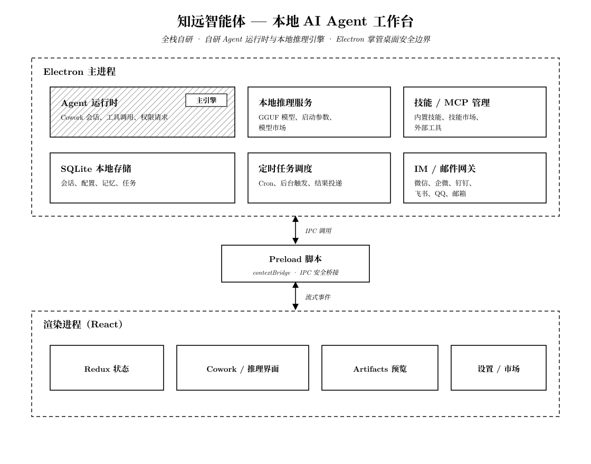

<p align="center">
  <picture>
    <source media="(prefers-color-scheme: dark)" srcset="public/zhiyuan-logo-dark-1600.png">
    
  </picture>
</p>

<h1 align="center">知远智能体</h1>

<p align="center"><strong>开源、本地优先的桌面 AI 智能体：内置免费模型开箱即用，支持本地 GGUF 模型，还能在微信、飞书、钉钉里直接派活。</strong></p>

<p align="center">
  <a href="https://github.com/rongxinzy/RongxinAI/stargazers"></a>
  <a href="https://github.com/rongxinzy/RongxinAI/releases"></a>
  <a href="LICENSE"></a>
  <a href="https://github.com/rongxinzy/RongxinAI/actions/workflows/ci.yml"></a>
  
</p>

<p align="center">
  <a href="https://www.rongxzyai.com/#download"><b>⬇️ 下载安装</b></a> ·
  <a href="#开始使用">快速开始</a> ·
  <a href="#开发者快速开始">源码运行</a> ·
  <a href="README.md">English</a>
</p>

<p align="center">
  
</p>

## 为什么选知远

- 🆓 **免费上手**：内置知远免费模型，无需第三方 API Key（需联网，额度以应用内为准），也可接入自己的模型服务。
- 💻 **本地模型**：模型市场一键选择 GGUF 模型与量化版本，可调上下文、GPU、线程（基于 llama.cpp 运行时）。
- 🛠️ **真能干活**：读写文件、运行命令，安装 Playwright 连接器后可操作浏览器；产出 PPT、Word、PDF、Excel。
- 💬 **接入常用 IM**：微信、企业微信、钉钉、飞书/Lark、QQ（英文界面另有 Telegram、Discord），另有邮件（IMAP/SMTP）技能。
- 🧩 **可扩展**：专家、技能（Skills）、MCP，支持定时任务。
- 🔒 **本地优先**：会话、配置、任务数据存本地；工具执行有授权模式。

## 开始使用

1. **下载**：从[官网](https://www.rongxzyai.com/#download)或 [GitHub Releases](https://github.com/rongxinzy/RongxinAI/releases) 获取安装包：**Windows** x64 轻量版、CPU 版、CUDA 版（`.exe`）；**macOS** Apple Silicon 与 Intel 的 CPU 版（`.dmg` 与 `.zip`）；**Linux** x64 CPU 与 CUDA 版（`.deb` 与 AppImage）。
2. **打开应用**：直接用内置免费模型对话，无需 API Key。
3. **派任务**：选择项目目录、描述任务，查看执行过程并处理授权请求。

开发者：`git clone https://github.com/rongxinzy/RongxinAI.git ZhiYuanAgent && cd ZhiYuanAgent && bun install && bun run electron:dev`（Node 24.x、Bun 1.4.0）。前置条件与更多命令见[开发者快速开始](#开发者快速开始)。

免费模型需要联网，服务可用性及额度以应用内提示为准。若无对应架构或版本的安装包，可[从源码运行](#开发者快速开始)。

### 使用本地模型

在「本地推理」中浏览模型市场，选择适合设备的 GGUF 模型及量化版本，安装后启动服务。工作台提供上下文长度、GPU 分配、线程等设置，可将运行中的本地模型用于智能体任务。

本地运行模型可以减少对云端推理的依赖。联网搜索、模型下载、远程 MCP 和消息渠道仍需要对应网络服务。

### 数据与权限

会话、配置和任务元数据保存在本机；本地文件由桌面执行环境访问。使用云端模型或远程工具时，请求所需内容会发送给相应服务。

工具执行遵循任务输入区选择的权限模式。默认「全部允许」，工具调用（包括不可逆操作）直接执行；切换到「请求权限」后，每个工具调用执行前都会显示授权请求。任务执行过程和结果可以在工作台中查看。

## 横向对比

| | 知远 | Manus | Claude Desktop | Cherry Studio | Open Interpreter |
| --- | :-: | :-: | :-: | :-: | :-: |
| 在微信/飞书/钉钉里直接派任务 | ✅（另有企业微信、QQ、邮箱） | ❌（连接器有 Slack、Gmail） | ❌（有 Slack 连接器） | ❌ | ❌ |
| 开源桌面应用 | ✅ AGPL-3.0 | ❌ 闭源 | ❌ 闭源 | ✅ AGPL-3.0 | ❌ 开源（Apache-2.0）但为终端工具，图形界面是另一个项目 |
| Windows / macOS / Linux 安装包 | ✅ | ❌ | ✅ | ✅ | ❌ |
| 内置 GGUF 模型市场（无需 Ollama） | ✅ 基于 llama.cpp | ❌ 仅云端 | ❌ 仅云端 | ❌ 需借助 Ollama / LM Studio | ❌ 需借助 Ollama / LM Studio |
| 免费模型 + 本地模型 + 完全开源 | ✅ 三者兼具 | ❌ 仅免费额度（每日 300 积分） | ❌ 仅免费版 | ✅ CherryAI 免费（Qwen3-8B）+ Ollama/LM Studio | ❌ 无内置免费模型 |
| 智能体：文件 + 命令 + 浏览器 | ✅ | ✅ | ✅ 仅付费版（Cowork） | ? | ✅（浏览器经 QA 技能） |

---

<p align="center">⭐ <b>觉得有用就点个 Star 吧</b>，这能帮更多人发现知远，也是我们持续更新的动力。</p>

## Star History

<a href="https://star-history.com/#rongxinzy/RongxinAI&Date">
  <picture>
    <source media="(prefers-color-scheme: dark)" srcset="https://api.star-history.com/svg?repos=rongxinzy/RongxinAI&type=Date&theme=dark">
    
  </picture>
</a>

## 选择一套喜欢的界面

知远当前内置一套主题插件 **Zenith**，提供 **浅色** 与 **深色** 两种外观。Zenith 是面向桌面效率的未来感设计体系：轻量玻璃质感、清晰字阶、紧凑留白，以及统一定义背景、控件 recipe 与交互状态的语义 token。

在「设置 → 外观」中选择 Zenith 预览卡片（仅注册一套主题时仍保留该入口），再选择浅色、深色或跟随系统；预览会随模式同步更新。仍保存旧主题 ID（Codex、大明风华、长安风物、未央金石等）的配置会自动回落到 Zenith。

<p align="center">
  <picture>
    <source media="(prefers-color-scheme: dark)" srcset="docs/theme-previews/appearance-settings-dark.png">
    
  </picture>
</p>

若要新增可打包的主题插件，可从[主题开发文档](src/renderer/theme/README.md)和[设计规范](DESIGN.md)开始。主题包提供展示数据，业务组件继续负责交互与状态。

## 开发者快速开始

需要 Git、Node.js **24.x** 和 [`package.json`](package.json) 指定的 Bun **1.4.0**。原生依赖无法使用预编译包时，需要 Python 与 C/C++ 构建工具；Windows 构建环境见[贡献指南](CONTRIBUTING.md)。

```bash
git clone https://github.com/rongxinzy/RongxinAI.git ZhiYuanAgent
cd ZhiYuanAgent
bun install
bun run electron:dev
```

开发启动脚本会准备消息渠道和记忆运行时，启动 Vite 与 Electron。首次准备运行时需要联网。若需要本地推理，可单独下载当前主机的推理运行时：

```bash
bun run llamacpp:runtime:download
```

### 常用命令

| 命令 | 用途 |
| --- | --- |
| `bun run build` | 类型检查、生产构建与运行时依赖检查 |
| `bun run test` | 运行项目测试脚本，处理原生模块环境并恢复 Electron 依赖 |
| `bun run lint` | 代码检查、主题生成一致性与样式归属审计 |
| `bun run format:check` | 检查代码格式 |
| `bun run test:bundle-budget` | 检查已构建的渲染端包体积 |
| `bun run theme:generate` | 修改主题定义后重新生成 CSS |
| `bun run compile:electron` | 编译 Electron 主进程，含原生依赖准备 |

### 打包

所有安装包都内置固定版本的模型网关，打包前需用锁定版本的 Go SDK 从源码构建。前置条件与构建命令见[贡献指南](CONTRIBUTING.md#packaging)。

#### 版本

版本由 `ZHIYUAN_UPDATE_VARIANT` 选择，决定随包内置哪种 llama.cpp 运行时。所有版本都内置离线组件，不做按需下载。

| 版本 | 平台 | 内置本地推理 |
| --- | --- | --- |
| `lite` | 仅 Windows x64 | 无（不含 llama.cpp） |
| `cpu` | Windows x64、Linux x64、macOS arm64 与 x64 | Windows/Linux 为 llama.cpp CPU + Vulkan；macOS 为 Metal |
| `cuda` | Windows x64、Linux x64 | 面向 RTX 40（sm_89）、CUDA 12.4 构建的 llama.cpp，附带所需 CUDA 运行库和 CPU 回退 |

| 命令 | 产物 |
| --- | --- |
| `bun run dist:win` / `dist:win:offline` / `dist:win:lite` | 未签名 Windows x64 lite 构建：WebView2 安装器 `ZhiYuanAgent-Setup-<version>.exe` 与 NSIS 更新器 |
| `bun run dist:win:cpu` / `dist:win:cuda` | 同上，cpu 或 cuda 版 |
| `bun run dist:win:signed` / `dist:win:signed:cpu` / `dist:win:signed:cuda` | Certum 签名的 lite / cpu / cuda；需要 `CERTUM_CERT_THUMBPRINT`，由发布流水线使用 |
| `bun run dist:linux:cpu` / `dist:linux:cuda` | Linux deb + AppImage，cpu 或 cuda（`dist:linux:cuda` 会用 `scripts/build-llamacpp-cuda-rtx40.sh` 在本机编译 CUDA llama-server） |
| `bun run dist:mac:arm64` / `dist:mac:x64` | macOS 安装包；发布流水线按 cpu 版构建 |

打包还涉及平台运行时、资源与签名配置，详见[贡献指南](CONTRIBUTING.md)、[RELEASING.md](RELEASING.md) 及 [`package.json`](package.json)。

### 项目结构

| 路径 | 职责 |
| --- | --- |
| [`src/renderer`](src/renderer) | 工作台、会话、设置、本地推理等 React 界面 |
| [`src/shared`](src/shared) | 共享 UI、类型与通信契约 |
| [`src/main`](src/main) | 桌面生命周期、任务执行、存储与系统服务 |
| [`src/main/preload.ts`](src/main/preload.ts) / [`src/main/preload/`](src/main/preload) | 通过 `contextBridge` 暴露受控 IPC，按领域拆分在 `preload/` 下 |
| [`src/renderer/theme`](src/renderer/theme) | 主题契约、组件外观、背景与生成器 |
| [`SKILLs`](SKILLs) / [`MCPs`](MCPs) | 内置技能与工具集成 |
| [`.github/workflows`](.github/workflows) | 测试、安装验收和发布流程 |

技术栈包括 Electron、React、TypeScript、Vite、Tailwind CSS、Redux Toolkit 和 SQLite，具体版本以 [`package.json`](package.json) 与 [`bun.lock`](bun.lock) 为准。

<details>
<summary>查看桌面架构</summary>

<p align="center">
  
</p>

渲染进程负责界面，Preload 提供通信边界，主进程负责会话、执行、数据与服务生命周期。任务消息、工具状态和授权请求通过事件回到界面；本地推理、技能、MCP 和消息渠道由对应服务管理。

</details>

## 参与项目

- [报告问题](https://github.com/rongxinzy/RongxinAI/issues/new?template=bug_report.yml)：附上系统、版本、复现步骤和相关日志。
- [提出功能建议](https://github.com/rongxinzy/RongxinAI/issues/new?template=feature_request.yml)：描述实际场景与预期行为。
- [贡献代码或文档](CONTRIBUTING.md)：先阅读 [`AGENTS.md`](AGENTS.md)；涉及界面时同时遵守 [`DESIGN.md`](DESIGN.md)。

欢迎通过 Star 关注项目，也欢迎分享你用知远完成的工作流。

## 致谢与许可证

感谢 [AnySearch](https://github.com/anysearch-ai) 对内置联网搜索能力的支持，相关实现见 [`SKILLs/web-search`](SKILLs/web-search)。

本项目采用 [GNU Affero General Public License v3.0](LICENSE)。
