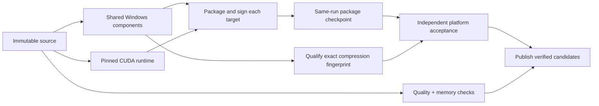

# Releasing 知远智能体 (ZhiYuan Agent)

Two workflows, one build, two channels: a `v*` tag runs `release.yml`, which publishes **beta**; `promote.yml` re-signs that same build as **stable**.

## 1. Tag → beta (`release.yml`)

1. Merge fixes/features to `main` or the active `release/v2026.10.19-win` hotfix branch.
2. Create and push an annotated tag on the approved source commit: `v<semver>` (no spaces), e.g. `v2026.10.16-build.1`.
   The tag is the **only** version source; CI sets `APP_BUILD_VERSION` from it.
3. Push triggers **Release (tag)**:
   - Quality gates + memory regression + signed Windows/macOS/Linux builds and installer smokes
   - Upload immutable artifacts to R2
   - Publish the **beta** update feed (`channels/beta-pointer.json`)
   - Create a GitHub **pre-release** with auto-generated release notes and attached installers

Beta users opt in under **Settings → About → Beta update channel**.

### Edition matrix

`build-inference-editions.yml` supports the seven targets below. The current hotfix publishes **Windows only** (`ZHIYUAN_RELEASE_PLATFORMS=win32` in release/promote); macOS/Linux remain available for verification. Release completeness uses the enabled platform set in `scripts/release/inference-edition-targets.mjs`.

| Platform | Editions | Release build |
| --- | --- | --- |
| Windows x64 | `lite`, `cpu`, `cuda` | `package:win:prepared:signed` with the edition environment; shared components built once (CUDA runtime on `windows-2022` with CUDA 12.4.1) |
| Linux x64 | `cpu`, `cuda` (deb + AppImage each) | `dist:linux:cpu`; cuda compiles llama-server in Docker (CUDA 12.4 / Ubuntu 22.04), then `dist:linux` |
| macOS arm64, x64 | `cpu` | `dist:mac:<arch>` with `ZHIYUAN_UPDATE_VARIANT=cpu` |

`lite` has no llama.cpp. `cpu` bundles llama.cpp CPU + Vulkan (Metal on macOS). `cuda` bundles an RTX 40 (sm_89) / CUDA 12.4 llama-server, its CUDA libraries, and a CPU fallback. Windows editions reuse one verified Magpie build; other targets build and verify their own architecture before packaging. Hooks still validate the pinned binary and the final signed digest.

**Pre-release verification:** `ci.yml` owns PR selection and `ci-gate` includes every selected job. Packaging changes run a Windows lite installer and a Linux CPU packaged-directory launch check; PRs do not compress unused Linux distribution installers. Ordinary source changes retain the full unit suite, type checks and bundle budget without an independent seven-target PR workflow. `build-platforms.yml` runs all seven targets with full installers nightly or selected platforms manually. Windows weekly/manual and Linux manual installation workflows call the same pipeline with extended acceptance, retaining NSIS UI and cold/cache-hit/uninstall checks. Directory-only mode is rejected for release or extended install acceptance.

### Build once, accept the same bytes

Windows Skill Python is finalized as a standalone interpreter inside the shared layer before compression. A Windows venv redirector retains the build host's absolute Python home even with `uv --relocatable`; it must not be shipped. The layer includes its base standard library/DLLs and one copy of the dependency wheels. A Windows regression moves the layer out of the build directory and launches both Python aliases with a clean PATH, including native stdlib and local-module imports. Fresh-runner package acceptance retains the full XLSX/PDF probes.

- Windows common resources, Skills and component archives have one producer for lite/cpu/cuda. Packaging rechecks content IDs, archive hashes and runtime pins; an unchanged archive is not compressed again. Compression qualification runs independently in parallel with packaging and is reused only for the identical archive, source content ID, compressor and qualification script. Acceptance downloads the report after restoring the package and verifies its fingerprint against the actual packaged component. Python probes and extraction thresholds remain mandatory on a new fingerprint.
- CUDA compilation runs in parallel with common preparation. Its cache includes the source/build scripts, CUDA/SM profile, runner image and runtime pins. Every cached file is checked before transfer. Cache eviction causes a rebuild; a cache hit is never a release acceptance result.
- Packaging uploads an uncompressed TAR checkpoint **before** acceptance. TAR preserves symlinks/executable modes. Source SHA, run ID, target, version and archive SHA-256 are verified before extraction on a fresh runner. Only acceptance creates `release-candidate-*` artifacts; publishing still verifies identity and completeness.
- The checkpoint also carries the final `package.json` version/edition and the signing certificate's public DER bytes. Independent Windows acceptance verifies the configured thumbprint, exact signer DER, Authenticode trust and timestamp without a Certum session or private key. Same-runner enterprise verification can still use its existing certificate store.
- Use **Re-run failed jobs** when acceptance fails: successful producer/package jobs and their checkpoints are retained, so no recompilation/signing is needed. Re-running all jobs deliberately rebuilds; do not run competing attempts concurrently. Checkpoints and qualification reports expire after 14 days, common/CUDA artifacts after 7 days. GitHub retention owns expiration; the old blanket seven-day artifact deletion job is removed.
- Each Windows check propagates its own exit code. Installer timing logs and process IDs/names are saved before bounded cleanup, and diagnostics are named by target and run attempt. Failed or cancelled targets cannot cancel other matrix legs. Missing artifacts or invalid/missing plans fail closed.
- `compile:electron` remains an explicit developer command. Production packaging emits JS through Vite once; `typecheck:electron` is no-emit and never rebuilds native modules. Node tests cache SQLite/PTY output by Node version/ABI, runner image, lockfile and patches, always probe it before use, and rebuild only missing/incompatible modules. Electron packaging/memory tests explicitly own the Electron ABI.
- Cache storage is shared by the repository. Bun packages use one OS/lockfile key across tests, memory checks, packaging and enterprise workflows; Electron downloads and compiled runtimes have separate keys. Magpie caches only the verified binary/manifest/license, not its source build directory. Avoid per-job copies of dependency caches: during this refactor the API reported about 12.6 GB in use and newly saved component caches disappeared within the same validation session. Cache misses remain safe rebuilds; a warm-cache latency guarantee depends on available repository capacity.

The earlier build.7 installer exit failure still requires a new Windows run with these diagnostics to establish its cause. No signed release or performance SLO is established by local tests.

Windows size gates live in `scripts/installer-shell/distribution-budget.cjs`: lite keeps hard limits (WebView2 setup 500 MiB total / 220 MiB non-component, components 300 MiB; NSIS updater 450 MiB). cpu enforces limits = measured size + an explicit margin (ceil 3%, whole MiB) for the WebView2 setup, the NSIS updater and the staged llama.cpp runtime (`scripts/ci/measure-llamacpp-bundled.cjs`); the measured run id is recorded next to each value, and these limits change only through a PR that cites a new measured run. cuda is publicly released but has no size limit (a deliberate decision for the public release); CI still measures and reports its sizes and enforces sha256/runtime integrity.

## 2. Promote → stable (`promote.yml`)

Manual **workflow_dispatch** with one input:

| Input | Meaning |
| --- | --- |
| `version` | SemVer **without** `v`, must match a completed tag release already on beta |

This job **does not rebuild**. It re-signs the existing beta generation as **stable**, moves the stable CDN pointer, runs post-publish smoke tests, and marks the GitHub release **latest** (non-prerelease).

### Rollback

Re-run **Promote** with the **previous** stable version string. When the requested version is older than the current stable pointer, CI sets `ALLOW_STABLE_ROLLBACK=true` and replaces the stable feed with that generation’s artifacts (already in R2).

## Hotfix

1. `fix/*` → PR → `main`
2. New patch tag (e.g. `v2026.10.16-build.2`) → wait for `release.yml`
3. **Promote** with that version

## Enterprise

Community OTA is unchanged. Enterprise Windows packages still use **Build Zhiyuan Enterprise Windows package (manual)** (`enterprise-windows.yml`).

## Secrets & environments

- **`release` environment**: R2, update manifest signing, Certum/Apple credentials (same as before).
- **GitHub**: `contents: write` on release/promote jobs for Releases API.
- **CDN**: `updates.rongxzyai.com` must serve `channel=beta` and `channel=stable` (v1 manifest + v2 electron feeds under `/v2/electron/{beta,stable}/`).

### Magpie gateway signing

The bundled Magpie binary is built locally from the commit pinned in `resources/magpie/upstream.json`; upstream ships no signed Windows or Linux binaries. Before packaging each target, run `bun run magpie:build --target <key> --go <pinned Go SDK>` and then `bun run magpie:verify --target <key>`. electron-builder hooks verify the unmodified compiler output again before packaging and after signing.

- **Windows**: `dist:win:signed` signs `resources/magpie/win32-x64/magpie.exe` with the same Certum certificate through `scripts/runtime-signing/sign-runtime.ps1` (it sits outside electron-builder's own sign walk), then rewrites its manifest with the signed SHA-256. Without a valid `CERTUM_CERT_THUMBPRINT` the binary stays unsigned and must match the build hash.
- **macOS**: `scripts/sign-magpie-macos.cjs` signs both `darwin-*/magpie` helpers with the Developer ID identity and the hardened runtime (it refuses to sign without it), seals their manifests, and the whole .app is notarized. `release.yml` checks the result with `scripts/ci/verify-packaged-magpie-signature.mjs`.
- **Allowlist**: `scripts/ci/magpie-gateway-allowlist.mjs` exempts only the exact pinned, unmodified gateway binary (hash and manifest must match `resources/magpie/upstream.json`) from the decoupling check.
