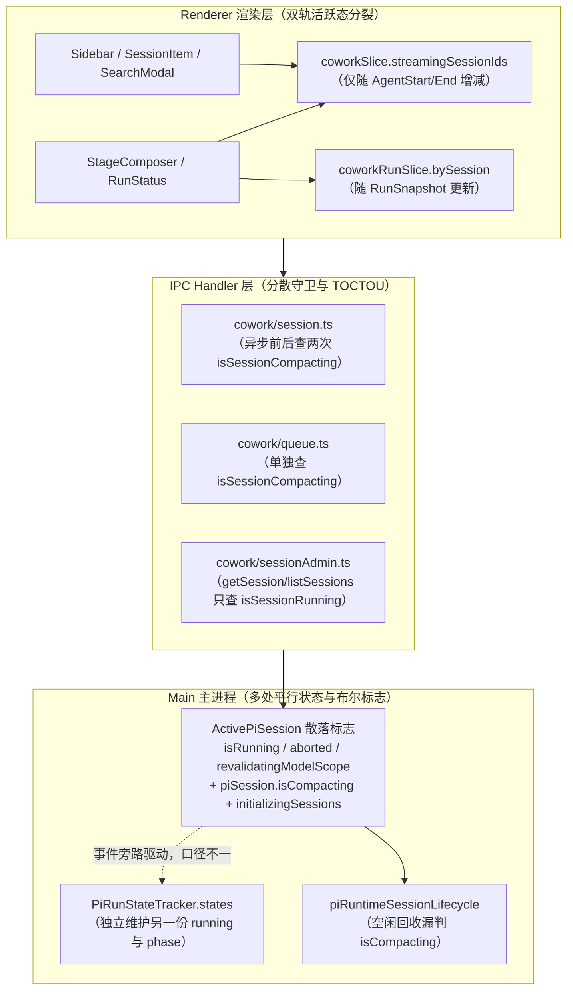
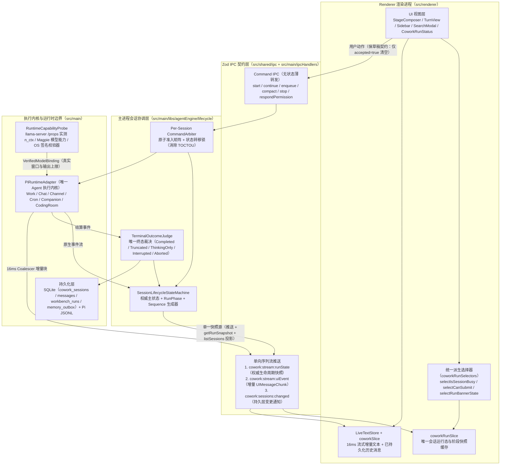
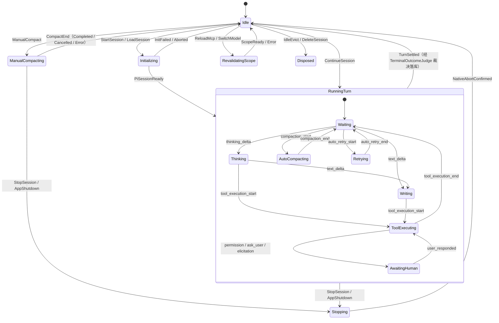
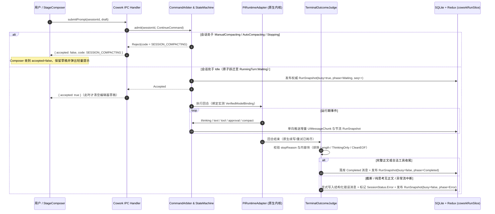
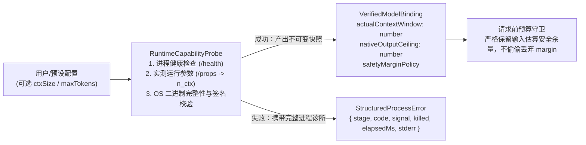

# 知远智能体（ZhiYuan Agent）会话执行与状态收敛目标架构

> [!IMPORTANT]
> 本文定义知远智能体会话生命周期、命令仲裁、运行态投影、模型能力契约与终态结算的**目标架构（North Star Architecture）**。后续针对 `agentEngine`、Cowork IPC、Redux 运行态与本地推理绑定的改动，均应朝本文收敛，禁止继续叠加局部布尔标志或双轨状态补丁。

---

## 1. 背景：为什么需要架构级收敛？

在近期连续迭代（`#1485`–`#1497`）中，表面上是零散的运行时与 UI 缺陷（本地推理提前截断、thinking-only 被判成功、空闲会话手动压缩时可并发发消息、压缩失败清空草稿、状态栏误报「正在重连」、Windows 冷启动签名超时），但底层暴露的是同一个架构症结：**缺少单一事实来源（Single Source of Truth）与明确的边界契约**。

### 1.1 现行架构的四处结构性分裂（As-Is 症结）

具体表现为四个根因：

1. **主进程活跃态口径自相矛盾**：`PiRuntimeAdapter.isSessionRunning()`、`PiRunStateTracker`、`piRuntimeSessionLifecycle` 各自维护一套「是否在忙」的判定。例如空闲会话手动压缩时，`PiRunStateTracker` 标记 `running: true`，而同一个 `getRunSnapshot` IPC 返回体里的 `runtime.isSessionRunning()` 以及 `listSessions`、`hasRunningSessions()` 却返回 `false`。
2. **并发门控散落在多层调用链**：`StageComposer`、`services/cowork.ts`、`ipcHandlers/cowork/session.ts`、`ipcHandlers/cowork/queue.ts`、`piRuntimeSessionContinuation.ts` 各自检查部分标志位，既存在异步间隙（TOCTOU），又容易在新操作（如连续两次 `compactSession` 或会话空闲回收）中漏检。
3. **渲染层维护两套并行运行态**：`coworkSlice.streamingSessionIds` 与 `coworkRunSlice.bySession` 并存，导致主舞台知道会话正在压缩，而侧边栏、搜索框、会话行指示器与焦点恢复逻辑看不到。
4. **能力探测与终态语义曾依赖启发式兜底**：在宿主层猜测上下文长度、硬限输出上限、或在投影层伪造提示文本，掩盖了底层真实能力与异常终态。

---

## 2. 核心架构原则（Architectural Invariants）

后续演进必须严格遵守以下 6 条架构不变量：

| 编号 | 原则 | 架构约束（Do & Don't） |
| --- | --- | --- |
| **I1** | **单一会话生命周期权威** | 每个 `sessionId` 在主进程由唯一的 `SessionLifecycleCoordinator` 持有互斥主状态（`SessionLifecycleState`）。**禁止**在 `ActivePiSession`、IPC 或 Bridge 中新增独立的 `isXxx` 布尔标志拼凑状态。 |
| **I2** | **单一入口命令仲裁** | 所有改变会话状态的操作（`Start` / `Continue` / `Enqueue` / `Steer` / `ManualCompact` / `ReloadMcp` / `Stop` / `Evict`）必须经由 per-session `CommandArbiter` 原子准入校验与状态跃迁。**IPC 层只做参数校验与错误码映射，不做业务并发判断**。 |
| **I3** | **单一运行态投影** | 主进程对外只发布一份权威 `CoworkSessionRunSnapshot`（含 `lifecycle`、`phase`、`busy`、`waitingOn`、`sequence`）。渲染层**彻底退役 `streamingSessionIds`**，全局所有 UI 组件与恢复逻辑统一从 `coworkRunSlice` 派生选择器读取。 |
| **I4** | **Pi 原生内核 + 实测能力契约** | `PiRuntimeAdapter` 保持唯一执行内核；模型上下文窗口、最大输出与推理能力必须来自**运行时实测快照**（如 `llama-server /props`、网关模型元数据）与显式用户上限，**禁止**在 Harness 层写死固定比例或静态截断阈值。 |
| **I5** | **显式终态裁决与保真诊断** | 回合结束统一由 `TerminalOutcomeJudge` 在 Pi 原生恢复耗尽后裁决：`Completed`、`OutputTruncated`、`ThinkingOnly`、`StreamInterrupted`、`Aborted`、`RuntimeError` 互斥且显式落库；跨进程调用（`llama-server` / `Magpie` / 签名校验）失败必须携带结构化退出诊断（`code / signal / killed / elapsedMs`）。 |
| **I6** | **人工/重活等待与通信失联解耦** | 快照显式区分 `activityKind: 'stream' \| 'background_job' \| 'human_wait'`。处于 `Approval / Question / Elicitation`（人工等待）或 `Compacting`（后台重活）时，UI 状态栏不得因无流式 token 增量而误判为「正在重连」。 |

---

## 3. 目标系统架构全景（To-Be Architecture）

---

## 4. 核心机制详细设计

### 4.1 权威会话生命周期状态机（Session Lifecycle State Machine）

将当前散落的 `initializingSessions`、`active.isRunning`、`active.aborted`、`active.revalidatingModelScope`、`active.piSession.isCompacting`、`isSessionReservedForDelivery` 收敛为单一有限状态机：

#### 命令 × 状态原子准入矩阵（Command Admission Matrix）

所有外部 IPC 与内部调度器统一调用 `arbiter.admit(sessionId, command)`，同步完成检查并切换占位状态，彻底消灭异步 `await` 前后的竞态窗口：

| 当前主状态 | `Start / Continue` | `Enqueue / Steer` | `ManualCompact` | `Stop` | `IdleEvict`（内存回收） | `isBusy`（侧栏/退出守卫/列表投影） |
| --- | --- | --- | --- | --- | --- | --- |
| `Idle` | 允许 → `Initializing` / `RunningTurn` | 拒绝（直接走 `Continue`） | 允许 → `ManualCompacting` | 幂等返回成功 | **允许** → `Disposed` | `false` |
| `Initializing` | 拒绝（`SESSION_BUSY`） | 允许入外层待发队列 | 拒绝（`SESSION_BUSY`） | 允许 → `Stopping` | **禁止** | `true` |
| `RunningTurn`（普通） | 拒绝（若为交付预留则 `RESERVED_FOR_DELIVERY`，否则引导走入队） | 允许（委托 Pi `steer/followUp`） | 拒绝（`SESSION_RUNNING`） | 允许 → `Stopping` | **禁止** | `true` |
| `RunningTurn:AwaitingHuman` | 拒绝（`AWAITING_USER_ACTION`） | 允许入待发队列 | 拒绝（`SESSION_RUNNING`） | 允许（取消挂起请求 → `Stopping`） | **禁止** | `true` |
| `RunningTurn:AutoCompacting` | 拒绝（`SESSION_COMPACTING`） | 拒绝（`SESSION_COMPACTING`，前端保草稿） | 拒绝（`SESSION_COMPACTING`） | 允许 → `Stopping` | **禁止** | `true` |
| `ManualCompacting` | 拒绝（`SESSION_COMPACTING`，前端保草稿） | 拒绝（`SESSION_COMPACTING`，前端保草稿） | 拒绝（`SESSION_COMPACTING`，防重入） | 允许 → `Stopping` | **禁止** | `true` |
| `RevalidatingScope` | 拒绝（`SESSION_REVALIDATING`） | 拒绝（`SESSION_REVALIDATING`） | 拒绝（`SESSION_REVALIDATING`） | 延迟或中断重载 | **禁止** | `true` |
| `Stopping` | 拒绝（`SESSION_STOPPING`） | 拒绝（`SESSION_STOPPING`） | 拒绝（`SESSION_STOPPING`） | 幂等复用同一停止 Promise | **禁止** | `true` |

> [!TIP]
> **前端草稿保留铁律**：提交动作返回统一结构 `{ accepted: boolean; code?: SubmissionRejectCode; error?: string }`。Composer **仅当 `accepted === true` 时清空编辑器**；任何拒绝码（如 `SESSION_COMPACTING`、`SESSION_BUSY`、网络/校验异常）一律保留用户已输入的文本、附件与选区。

---

### 4.2 命令仲裁、流式投影与终态裁决标准时序

---

### 4.3 运行态展示与失联检测解耦契约

为了彻底消除 `#1497` 修完 `Compacting` 后、`Approval` 仍会被 `UnconfirmedMs` 误报为「正在重连」的同类缺陷，将**状态栏展示优先级**定义为纯函数决策树，不再用单一时间戳一刀切：

1. **非活跃态**（`!snapshot.busy`）：不渲染运行条。
2. **人工等待态**（`phase === Approval | Question | Elicitation`）：始终展示「等待你的确认 / 回答」（无超时变「重连」逻辑，因为引擎本就在等用户）。
3. **后台长耗时维护态**（`phase === Compacting | Revalidating`）：始终展示「正在压缩上下文 / 正在同步工具配置」（主进程在此期间按固定心跳刷新 `confirmedAt`）。
4. **流式生成 / 工具执行态**（`phase === Waiting | Thinking | Writing | Tool | Retry`）：仅当主进程心跳超过 `UnconfirmedMs` 未更新 `confirmedAt` 时，才降级提示「正在重连」，并在窗口恢复可见时触发 `CoworkRunSync.verify()` 对账。

---

### 4.4 外部进程与模型能力边界契约（Capability & Process Boundary）

针对 `llama-server`、`Magpie` 与 OS 安全校验（如 Windows Authenticode），统一采用**「启动探测即契约，禁止事后猜配置」**模式：

- **禁止猜参数**：凡是服务端提供自描述接口（如 `llama-server /props`），一律以实测返回值为准；读取不到有效值视为启动未就绪，不回退到可能失真的静态默认值。
- **平台校验降噪与缓存**：二进制签名校验（如 `magpie/integrity.ts`）应按**「文件路径 + 大小 + mtime + SHA-256」**在主进程内存/本地受控缓存中记住同生命周期内已验证通过的可执行文件，避免每次冷/热启动重复拉起外部 `powershell.exe`；且任何子进程失败统一经共享 `formatExecFailureDiagnostics()` 输出 `code / signal / killed / elapsedMs`。

---

## 5. 现行模块向目标架构的映射表

| 领域 | 现行实现（As-Is） | 目标收敛形态（To-Be） | 动作 |
| --- | --- | --- | --- |
| 主进程生命周期 | `initializingSessions` + `ActivePiSession.{isRunning, aborted, revalidatingModelScope}` + `piSession.isCompacting` | `src/main/libs/agentEngine/lifecycle/sessionLifecycleCoordinator.ts`（唯一状态机与 `isSessionBusy` 出口） | **新建并收拢** |
| 并发命令准入 | `ipcHandlers/cowork/{session,queue,sessionAdmin}.ts` + `piRuntimeSessionContinuation.ts` 分散 `if` | `coordinator.admitCommand(sessionId, cmd)` 统一原子校验，IPC 层删除业务状态 `if` | **收敛删除重复守卫** |
| 主进程运行快照 | `PiRunStateTracker` 独立维护 `running`，与 `runtime.isSessionRunning()` 不一致 | `PiRunStateTracker` 直接由 `SessionLifecycleCoordinator` 驱动，`getRunSnapshot` / `listSessions` / `hasRunningSessions` 共用同一份 `busy` 真相 | **合并口径** |
| 渲染层活跃态 | `coworkSlice.streamingSessionIds` 与 `coworkRunSlice.bySession` 双轨并存 | **删除 `streamingSessionIds`**；`Sidebar`、`CoworkSessionItem`、`CoworkSearchModal`、`CoworkRunSync` 全部改读 `coworkRunSelectors` | **退役旧状态** |
| 状态栏文案决策 | `CoworkRunStatus.tsx` 靠顺序 `if` 判断，`Approval` 仍会被 `UnconfirmedMs` 覆盖 | 按 `activityKind` 分离人工等待、后台维护与流式失联检测 | **修正状态机映射** |
| 终态结算 | `piFinalResponse.ts` + `piRuntimeTurnEvents.ts`（`#1496` 已基本收正） | 保持单一 `TerminalOutcomeJudge` 模块边界，新增终态类型必须在此集中声明 | **加守护测试固化** |
| 二进制签名校验 | `src/main/magpie/integrity.ts` 每次拉起 `powershell.exe`（30s 超时） | 已验证哈希+签名结果按二进制指纹缓存，复用统一子进程诊断格式化工具 | **优化可靠性** |

---

## 6. 分阶段演进路线图（Phased Iteration Plan）

为避免大爆炸式重写（Big-Bang Rewrite）引入新回归，建议拆分为 **4 个独立、可验证、可随时合入的阶段 PR** 推进：

### Phase 1：主进程会话状态机与命令仲裁收敛（核心止血）
- **范围**：在 `src/main/libs/agentEngine/` 引入 `SessionLifecycleCoordinator` 与 `CommandArbiter`；统一 `isSessionBusy`、`isSessionCompacting`、`compactSession`（补防重入）、`piRuntimeSessionLifecycle`（补 `ManualCompacting` 防误回收）、`getRunSnapshot` 与 `listSessions` 的运行态口径；将 `ipcHandlers/cowork/{session,queue,sessionAdmin}.ts` 的散落并发检查收进 `admitCommand`。
- **验收标准**：并发 `continue / enqueue / compact / stop / evict` 状态转移表全矩阵单测通过；IPC handler 不再直接拼装运行时布尔条件。

### Phase 2：渲染层退役 `streamingSessionIds`，统一 `coworkRunSlice` 真相
- **范围**：新增统一选择器（`selectIsSessionBusy`、`selectBusySessionIdSet`、`selectCanSubmitToSession`）；迁移 `Sidebar.tsx`、`useWorkspaceSidebarState.ts`、`CoworkSearchModal.tsx`、`CoworkSessionItem.tsx`、`CoworkRunSync.ts`；删除 `coworkSlice.streamingSessionIds`；顺手修复 `CoworkRunStatus.tsx` 中 `Approval` 超时误报「正在重连」问题。
- **验收标准**：空闲会话触发手动压缩或进入长时间工具审批时，主对话区、侧边栏运行点、搜索列表、状态栏与窗口切回对账（`verify`）表现 100% 一致。

### Phase 3：运行时能力边界与外部进程契约固化
- **范围**：抽离共享子进程诊断辅助函数；为 `magpie/integrity.ts` 增加基于二进制指纹（SHA-256 + 文件元数据）的同版本验证缓存或原生 WinVerifyTrust 路径评估；梳理模型预算守卫边界，确保实测能力与估算余量分层清晰。
- **验收标准**：Windows 冷启动不再因重复拉起 PowerShell 阻塞模型服务启动；所有外部子进程异常均具备统一的 `code / signal / killed / elapsedMs` 诊断格式。

### Phase 4：架构守护门禁（Architecture Fitness Tests）
- **范围**：新增 `tests/architectureSessionStateGuards.test.ts`（类似现有的 `tests/streamingGuards.test.ts`），通过静态扫描锁死：
  1. `src/renderer/` 中不得再出现独立维护活跃会话 ID 数组的 slice 字段；
  2. `src/main/ipcHandlers/cowork/` 不得直接读取底层会话内部标志做并发拼装；
  3. 状态机的每一个 `SessionLifecycleState` 都必须在准入矩阵与 UI 状态栏映射中有显式分支（利用 TypeScript `satisfies Record<SessionLifecycleState, ...>` 穷尽检查）。
- **验收标准**：门禁接入 `bun run test:unit`，靠编译器穷尽检查 + 守护单测防止后续迭代再次退化。
