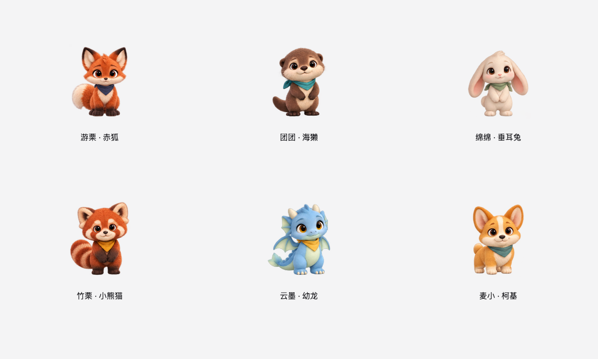
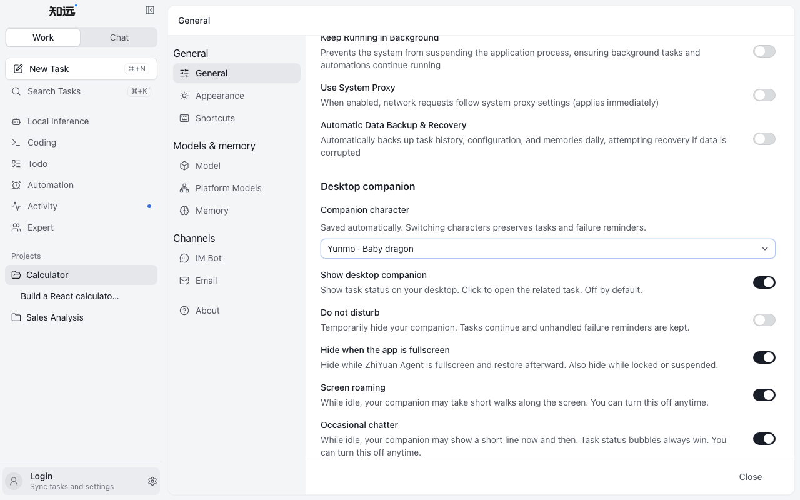
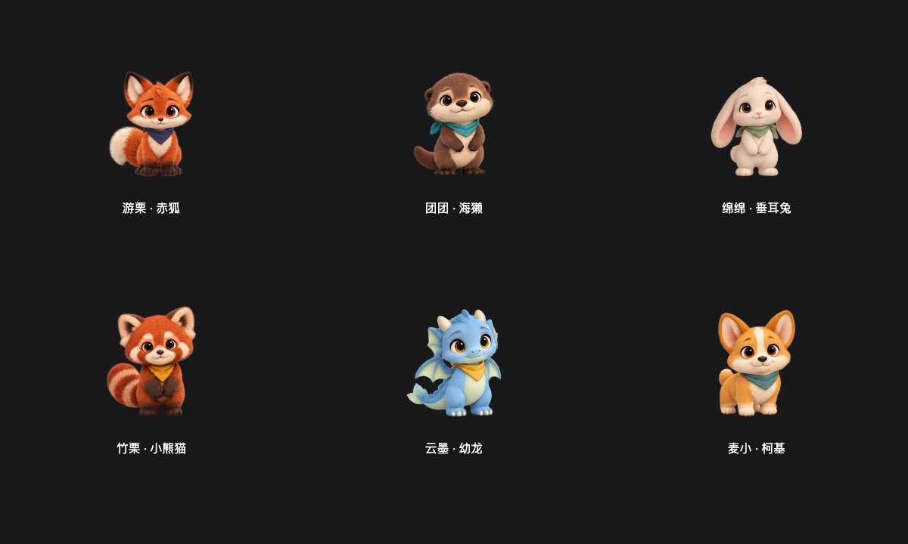
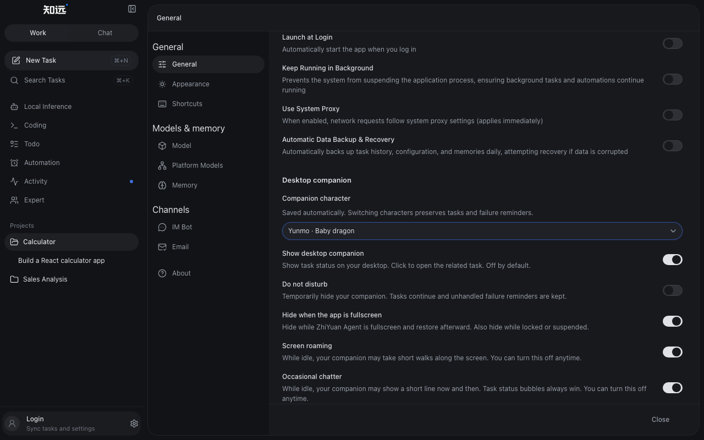
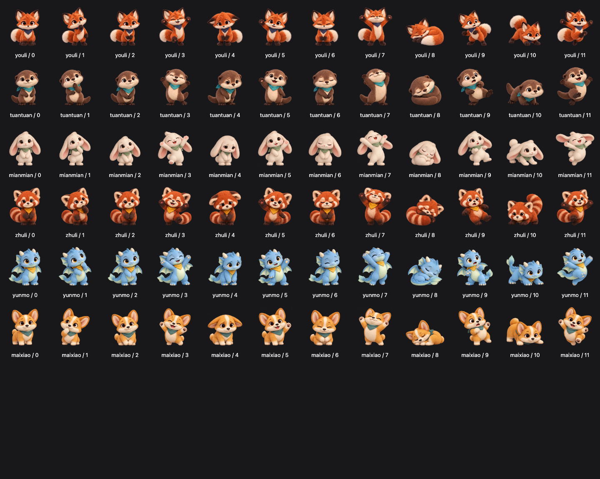

# 桌面伙伴：长序列动作与六种新形象

基线：`origin/main` 的 `7a42c34c`（2026-10-24 核对）。实现位于分支 `codex/desktop-pet-sequences`，使用独立工作树，主 checkout 无改动。此目录是本轮交付走查记录，不覆盖已有主界面验收基准。

## 交付

保留小远，新增游栗（赤狐）、团团（海獭）、绵绵（垂耳兔）、竹栗（小熊猫）、云墨（幼龙）、麦小（柯基）。新角色各有 12 个姿态，素材由内置 `image_gen.imagegen` 生成并修整；[素材与提示词](../../src/renderer/assets/desktop-pet/README.md)。

5 套动作按角色节奏约 6–15 秒：观察、点头、伸展、庆祝、小憩。以经过时间采样，包含起势、停顿与收势，姿态边界短暂融合；小远用原六姿态映射。角色选择位于设置 → 通用 → 桌面伙伴，自动保存，不改变启用默认值。

任务状态优先于表演；拖动、漫游、减少动效和隐藏均可中断。菜单动作先让漫游休息，避免播放被行走状态吞掉。Electron 隐藏窗口有时仍报告 `document.hidden=false`，现由主进程发送明确显隐消息；Ready 时重发，避免隐藏窗口重载后恢复动画。隐藏不积压补播。掩码按当前姿态包络缓存（每图最多 32 项），避免读取每帧像素，也不把其他姿态的空白区域全部纳入点击区。

| 明暗角色 | 设置 |
| --- | --- |
|  |  |
|  |  |

## 验证边界

- `bunx vitest run src/renderer src/shared`：341 个文件、1,877 项通过；最终桌宠专项 11 个文件、53 项通过。
- 完整 `bun run web:preview:check`：24 项通过、1 项仓库原有跳过；最终桌宠专项 12 项通过。设置分组另外加入完整 axe 断言（含对比度）。Browser 插件不可用，使用仓库 Playwright。
- 前后端类型检查、`build`、`compile:electron`、bundle-budget、格式、常规/生产 Knip、源码行数和大文件检查通过。生产启动图 1.75 MiB，preload 0.86 MiB。
- `lint` 退出 0、主题生成检查与审计通过；oxlint 有 292 条主线存量警告，分布在 49 个未修改文件，本轮改动文件无警告。Knip 有 3 条既有配置提示。完整浏览器走查另报告一条主页面既有的 warn-only `aria-required-children`，未弱化该检查。
- `bun run electron:dev` 使用 `/tmp/zhiyuan-pet-sequences-user-data`：真实 IPC 切换全部七角色、免打扰停帧、隐藏后重载、恢复、可见状态重载和关闭通过。原生启动有未配置渠道、未安装本地推理/Python 等现存环境提示；桌宠页面无新增 pageerror。没有发起真实模型任务、安装包验收或发版。

## DESIGN.md 第十节逐项自查

规范依据：v4 Quiet Studio，第八节动效边界、第十节检查清单、第十一节桌面伙伴媒体授权、第十三节设置自动保存；对照 `docs/design/reference/index.html`。复用 `SettingsToggleRow`、`Field`、`Select` 及原主题 recipe，没有新增 token、样式档或 UI 动画。

| 检查项 | 结果与证据 |
| --- | --- |
| 一屏一个重心 | 通过：设置保持行式表单，角色只在独立透明媒体窗口；截图缩览无第二视觉中心 |
| 品牌色限可执行语义、单屏不超过两处 | 通过：新增选择器只有焦点环，保留共享 recipe |
| 无毛玻璃、渐变控件、光晕、上浮缩放 | 通过：未新增；角色媒体动作使用明确授权例外 |
| 三级文字层级，无新增字号/色彩/卡片 | 通过：共享 Field/Select，原设置标题与行式结构 |
| 同类规格与文字起点 | 通过：原共享 Select 与 ToggleRow，实际截图检查 |
| 文案、默认值与语义一致 | 通过：中英文七角色名称齐全，默认关闭，免打扰不清失败 |
| 对照参考实现 | 通过：只增加设置字段，不修改主界面框架或基准 |
| 外观归 recipe | 通过：新选择器无局部外观样式；独立 canvas 只处理媒体几何 |
| 字号/字重刻度 | 通过：复用现有共享样式，没有新增字号档 |
| 间距与圆角 | 通过：FieldGroup/Field 原规格，未新增圆角 |
| 弹窗密度、导航行 | 不适用：没有新增弹窗、导航行 |
| hover 阴影、浮层边框 | 通过：复用 Select 浮层，无新增阴影 |
| 正文/控件/焦点对比 | 通过：设置分组明暗 axe 含 color-contrast；复用共享焦点 recipe |
| 主要动作常显、键盘可达 | 通过：形象选择常显，键盘打开/退出、开关 Space 验证 |
| 指定共享组件、无重复标题 | 通过：共享控件；为 ToggleRow 增加可选标题层级，桌宠分组 h2→h3，原调用默认不变 |
| 适用控件状态 | 通过：hover、pressed、focus、disabled、selected、open、保存中；invalid 不适用（枚举选择，无自由输入） |
| 动效与减少动效 | 通过：UI 控件保持原 recipe，角色例外已记规范；减少动效停止序列与变形 |
| 原地加载、真实状态 | 通过：新图解码后原位替换，过期解码不覆盖新选择；任务优先级与失败保留有回归 |
| 窗口、长文本、中英文、portal | 通过：1280×800、1440×900、1024×768、940×700、760×700 无横向溢出，另查 1920×1080；英文长说明可换行，选择弹层可达 |
| 明暗及热切换状态保留 | 通过：选择弹层打开时热切换、选中、焦点、开关保存值保留；本轮不涉及草稿/编辑器 |
| theme:generate / lint / format | 通过：无 token/recipe 改动，generate 不适用；theme:check/audit、lint、format:check 通过，存量警告见上 |
| 共享契约验证 | 通过：渲染器/共享回归、前后端类型、生产构建、bundle-budget |
| 浏览器与真实 Electron | 通过：范围与环境提示见验证边界；真实模型、跨平台打包不在本轮覆盖内 |

获准偏离：仅六种角色媒体与长序列表演；已写入 DESIGN.md。没有修改、覆盖或豁免主题/CI 门禁。
