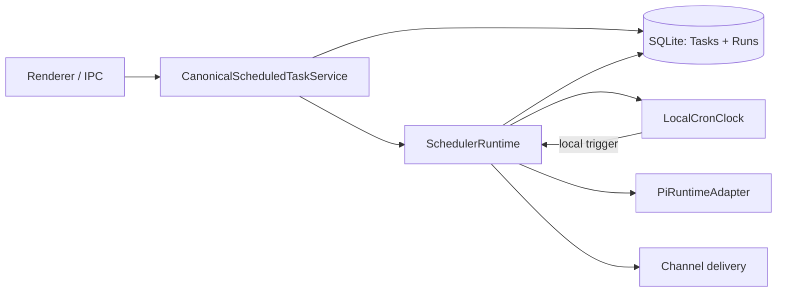

# 定时任务：Canonical Scheduler

## 目标

本地 SQLite 持有任务定义、执行状态和投递记录。主进程的调度运行时维护本地时钟，Pi 执行任务。配置了渠道投递时，调度运行时将已完成的回复交给对应渠道的 cc-connect sidecar。

## 所有权与边界

| 部分 | 责任 |
| --- | --- |
| `SqliteScheduledTaskStore` | Task、Run、去重 claim、崩溃恢复 |
| `SchedulerRuntime` | 本地时钟的启停、认领触发、记录 Run 结果、分派投递 |
| `LocalCronClock` | `at` / `every` / `cron` 到点通知调度运行时 |
| `PiScheduledTaskExecutor` | 创建或恢复 Pi 会话并执行 |

## 会话绑定策略

任务执行支持三种绑定方式：

1. `per-run`：每次触发创建新的 `Scheduled` 会话，适合互相独立的报告和提醒。
2. `task`：按任务 ID 创建一个稳定的专属会话，后续 Run 继续该会话；同一任务的执行在执行器内串行化。
3. `existing`：通过 `Main + zhiyuan:<sessionId>` 绑定已有 UI/IM 会话，运行结果追加到该会话。

三种方式都保留独立的 canonical Run 记录；会话是否复用不影响 Run 级审计、状态和投递记录。

## 触发与恢复

本地时钟提供任务 ID、调度版本和触发时间。运行时以 `(taskId, scheduleVersion, scheduledAt)` 原子认领 Run，跳过禁用任务、过期版本和重复触发。手动执行使用同一认领与执行路径，并允许执行已暂停的任务。

应用启动时，`recoverInterruptedRuns()` 将遗留的运行记为失败。调度运行时从 SQLite 恢复已启用的任务，并继续安排将来的触发。应用停止时，调度运行时先停时钟，再等待已认领的任务结束。

## 验证重点

- 停止时钟后没有新的自动触发。
- 过期版本和重复触发都不创建新 Run。
- Pi 成功、失败及进程中断更新同一条 Run。渠道投递由独立记录反映。
